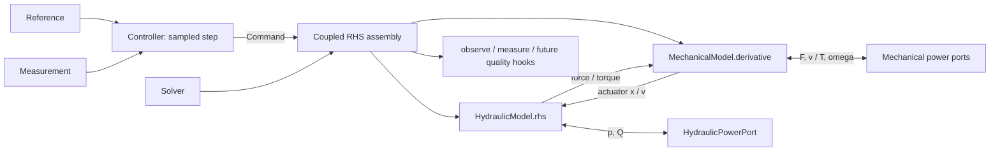
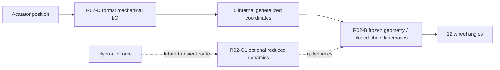

# R01 architecture

边界原则：控制器离散采样；物理模型提供连续 RHS；solver 不属于任何单一物理模块；耦合在同一次 RHS 评价中双向交换位移/速度与力/力矩。功率残差作为后续守恒测试接口。

## Mechanical routes after R02-D

- R02-B is the geometry and closed-chain kinematics core.
- R02-C1 is an optional reduced dynamics core for future force, transient and load calculations.
- R02-D is the current formal external mechanical I/O layer.

Normal position-to-angle use does not pass through R02-C1. CUSTOMER hardpoints
remain frozen; calibration is limited to explicit sensor/mapping/zero-offset
parameters unless a future bounded level-2 hardpoint-correction decision is approved.

## R02-E vehicle coordination route

    target Axle1 mean angle + steering mode
                    |
                    v
    generalized-Ackermann / ICR coordinator
                    |
        ideal 12-wheel targets
                    |
                    v
    bounded fit of q_front, q3, q4, q5, q6
                    |
                    v
    required actuator positions (R02-D conversion)
                    |
                    v
    MechanicalSteeringIOModel -> frozen R02-B -> actual 12 wheel angles

R02-E is a low-speed geometric coordination baseline, not a PID controller,
hydraulic transient model, steering-wheel mapping, or vehicle-dynamics model.
Preset ICR location and coordination gains are centralized and calibratable;
CUSTOMER hardpoints remain frozen. R02-C1 remains an optional parallel route
for future force-driven transient mechanics.

## R02-E vehicle coordination route

    target Axle1 mean angle + steering mode
                    |
                    v
    generalized-Ackermann / ICR coordinator
                    |
        ideal 12-wheel targets
                    |
                    v
    bounded fit of q_front, q3, q4, q5, q6
                    |
                    v
    required actuator positions (R02-D conversion)
                    |
                    v
    MechanicalSteeringIOModel -> frozen R02-B -> actual 12 wheel angles

R02-E is a low-speed geometric coordination baseline, not a PID controller,
hydraulic transient model, steering-wheel mapping, or vehicle-dynamics model.
Preset ICR location and coordination gains are centralized and calibratable;
CUSTOMER hardpoints remain frozen. R02-C1 remains an optional parallel route
for future force-driven transient mechanics.
