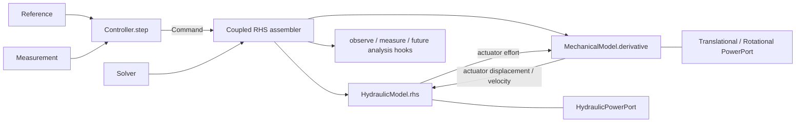

# R01 架构设计与参考项目审计交接

- 轮次：R01
- 日期：2026-09-14
- 工作区：`E:\15_project`
- 分支：`r01-architecture`

## 1. 本轮完成内容

1. 完整审计 hydrasim 指定源码范围，固定上游 commit 和 MIT 许可证信息。
2. 初始化独立 `steering-sim` src-layout Python 项目，没有把第三方仓库并入正式源码。
3. 建立机械、液压、控制、耦合、求解器、I/O 包边界，以及 unit/physics/integration 测试分层。
4. 冻结机械状态/载荷/运动学/约束/执行器运动接口。
5. 冻结液压压力/流量/控制输入/机械反馈/执行器力或力矩/动态参数更新接口。
6. 冻结 `Controller.step(measurement, reference, dt) -> command`，提供最小 PID 和 SMC 基线位置。
7. 定义三类最小功率端口与功率残差结构，不建立通用 Bond Graph。
8. 定义独立 Solver 抽象、显式 Euler/RK4 参考实现和 SciPy RK45/BDF/Radau 适配器。
9. 建立参数来源枚举、置信度、单位、备注和运行期可追溯更新机制。
10. 加固 `.gitignore`，排除 AMESim 工程、甲方资料、`data/raw`、临时结果及参考仓库。

明确未做：正式机械/液压物理模型、质量性能评估、退化预测、雨流计数、GUI，以及“误差 ≤10%”验证结论。

## 2. 新增/修改文件

```text
.gitignore
README.md
pyproject.toml
configs/
  README.md
  example_interface.toml
data/
  example/README.md
  validation/README.md
docs/
  architecture/README.md
  decisions/0001-continuous-physics-discrete-control.md
  decisions/0002-minimal-power-ports.md
  equations/README.md
  references/hydrasim_architecture_audit.md
  review/R01_handoff.md
  validation/README.md
examples/README.md
src/steering_sim/
  __init__.py
  control/{__init__.py,base.py,pid.py,sliding_mode.py}
  core/{__init__.py,lifecycle.py,parameters.py,ports.py}
  coupling/{__init__.py,interfaces.py}
  hydraulics/{__init__.py,base.py,components.py}
  io/{__init__.py,parameters.py}
  mechanics/{__init__.py,base.py}
  solvers/{__init__.py,base.py,explicit.py,scipy_ivp.py}
tests/
  integration/{test_package_install.py,test_solvers.py}
  physics/README.md
  unit/{test_abstract_interfaces.py,test_imports.py,test_parameters.py,test_ports.py}
```

## 3. hydrasim 审计结论

- 审计仓库：<https://github.com/LoneWolfDog/hydrasim>
- commit：`74992f744ee41560700566e87374068961981c98`
- license：MIT License，Copyright (c) 2026 HydraServo。
- 值得借鉴：src-layout、物理核心不依赖 GUI、控制器不持有 plant、生命周期分离、集中状态、可替换 stepper、局部隐式压力求解、分层测试。
- 液压参考：四通阀孔口流量、双腔连续性、位置相关容积、跨腔泄漏、缸力/马达力矩、母线容腔和显式溢流支路。
- 不可迁移：三连杆动臂/斗杆/铲斗动力学、土壤贯入、回转马达/制动、boom 平衡阀、挖掘机 LUDV 抢流、默认参数和经验钳位。
- 精度边界：集总等温流体、简化阀/泵/管路/摩擦/刚体机构及硬钳位；TLM 实现不是通用分布参数管网求解器。
- 上游测试主要证明内部实现自洽和趋势，不是本设备的独立实物验证；容差也并非统一 10%，不能作为“模型误差 ≤10%”的直接证据。

完整结论见 `docs/references/hydrasim_architecture_audit.md`。

## 4. 当前架构图



## 5. 三模型接口定义

### 机械

- `MechanicalState(q, q_dot, q_ddot)`
- `MechanicalInputs(external_load, actuator_effort)`
- `derivative(t, state, inputs) -> MechanicalDerivative(q_dot, q_ddot)`
- `forward_kinematics(q)`
- `constraint_residual(state)`，为运动副/约束及未来 DAE 预留
- `actuator_kinematics(state) -> (displacement, velocity)`
- `actuator_ports(...)` 返回平动或转动功率端口
- `reset / observe / measure`

### 液压

- `HydraulicState(pressure, flow, internal)`
- `HydraulicInputs(command, actuator_displacement, actuator_velocity)`
- `rhs(t, state, inputs) -> HydraulicState`（各字段代表导数）
- `outputs(...) -> HydraulicOutputs(actuator_effort, supply_ports, actuator_ports)`
- `update_parameters(Mapping[str, ParameterMeta])`，供后续退化模型动态修改
- 泵、阀、缸、容腔分别有小型抽象组件接口
- `reset / observe / measure`

### 控制

- `Controller.reset()`
- `Controller.step(Measurement, Reference, dt) -> Command`
- 控制器不得持有 plant；本轮含 `PIDController` 和 `SlidingModeController` 最小基线，不代表已调参或性能达标。

## 6. 功率接口定义

- `HydraulicPowerPort(pressure, flow)`：`P_h = p * Q`
- `TranslationalPowerPort(force, velocity)`：`P_t = F * v`
- `RotationalPowerPort(torque, angular_velocity)`：`P_r = T * omega`
- 统一约定：端口功率正值表示流入端口所属组件。连接两组件时耦合器必须反转其中一侧方向。
- `PowerBalance.residual` 汇总端口功率和损失，供后续守恒测试使用。

## 7. 参数来源机制

`ParameterMeta` 强制包含 `name/value/unit/source/confidence/notes`。`source` 只能取：

```text
CUSTOMER, AMESIM, DATASHEET, LITERATURE, CALIBRATED, ASSUMED
```

`confidence` 范围为 `[0,1]`。`ParameterSet` 集中保存并显式更新参数；`with_value` 和 `update_parameters` 为后续退化参数更新保留可追溯入口。R01 示例参数明确标为 `ASSUMED`，不得用于工程结论。

## 8. 测试命令与完整结果

安装验证：

```text
E:\ProgramData\anaconda3\python.exe -m pip install -e . --no-deps --no-build-isolation
Successfully built steering-sim
Successfully installed steering-sim-0.1.0
```

由于机器裸 `python` 指向 AMESim 自带 Python 3.6.8/pip 18.1，不支持本项目 `requires-python >=3.10` 和现代 PEP 517 editable 安装，测试会话先把 `E:\ProgramData\anaconda3` 放到 PATH 首位，再执行要求的原命令：

```text
python -m pytest -q
............                                                             [100%]
12 passed in 10.24s
```

覆盖：import、三类 PowerPort、参数元数据与更新、Controller/Mechanical/Hydraulic 替代实现实例化、distribution metadata 安装、统一 RHS 显式求解器和 BDF/Radau 预留。

## 9. 已知问题

1. 本轮只有接口和最小算法基线，没有客户构型对应的物理实现。
2. 机械/液压联合状态打包、事件、Jacobian、质量矩阵和 DAE solver API 要在获得构型后于 R02/R03 细化。
3. PID/SMC 仅证明接口可用，未完成抗饱和策略评审、滤波、抖振处理、鲁棒性分析或调参。
4. 功率端口已定义，但尚无实体执行器做跨域守恒测试。
5. 尚未定义“误差 ≤10%”的信号、工况、范数、时间窗和低幅值处理。
6. 本机命令行默认 Python 是 AMESim 3.6；后续需显式使用 Python 3.10+ 环境或激活项目虚拟环境。
7. 当前项目许可证暂标 `Proprietary`，需甲方/项目管理确认正式授权策略。

## 10. R02 机械模型所需甲方输入资料

必需：

- 转向系统总体构型与运动链：方向盘/电机/转向器/齿条/摇臂/拉杆/转向节/车轮的实际方案。
- 机械总装图、二维/三维关键坐标、零位定义、左右轮转角定义、坐标系和正方向。
- 各运动副类型、自由度、约束、间隙和机械限位。
- 齿轮/丝杠/循环球/齿条等传动比及随位置变化规律，正反向效率和回差。
- 液压缸安装点、缸径/杆径/行程/死区容积；或摆动马达排量和连接几何。
- 各运动件质量、质心、转动惯量；无法提供时需 CAD 导出质量属性。
- 摩擦、阻尼、刚度、密封摩擦、结构柔度和间隙的资料或可辨识试验。
- 转向轮胎/地面等效负载：车辆质量、轴荷、轮胎、主销几何、车速/路面/胎压范围及回正力矩或台架负载谱。
- 机械效率、功率/力矩/力/速度/角度传感器位置、量程、采样率和信号定义。
- 正常与极限工况、允许转角/角速度/角加速度、碰限位条件和安全边界。
- 可用于独立验证的 AMESim 输出或台架/整车时序数据，包含统一时间基准、单位和工况说明。

建议同时提供：部件数据表、供应商图纸版本、参数来源/置信度、温度范围、制造公差、标定记录及 R02 验收工况。

## 11. git status

交付提交后预期：工作树 clean；`reference/` 被忽略。提交后已用 `git status --short --branch` 复核，精确终态随聊天交付一并报告。

## 12. 当前 branch

`r01-architecture`，未 merge 到 `main`。

## 13. commit hash

R01 交付提交即本文件所在提交。Git 提交哈希由包含本文件在内的完整提交内容计算，无法在同一个提交中自嵌其最终哈希；精确不可变 hash 在提交完成后由 `git rev-parse HEAD` 获取，并在本轮最终聊天交付中报告。

